<div align="center">

  

  # 🔄 Awesome Change Management

  <p align="center">
    <strong>A curated directory of top-tier Enterprise SaaS &amp; Sovereign Open-Source Tools for ITIL 4 Change Enablement, Release Governance, CAB Automation &amp; Risk Assessment.</strong>
  </p>

  <p align="center">
    <a href="https://github.com/ishandutta2007/Awesome-Awesome-Awesome"></a><a href="https://discord.gg/jc4xtF58Ve"></a>
    <a href="https://github.com/ishandutta2007/Awesome-Change-Management/stargazers"></a>
    <a href="https://github.com/ishandutta2007/Awesome-Change-Management/network/members"></a>
    <a href="https://github.com/ishandutta2007/Awesome-Change-Management/blob/main/LICENSE"></a>
    <a href="https://github.com/ishandutta2007/Awesome-Change-Management/pulls"></a>
    <a href="https://github.com/ishandutta2007"></a>
  </p>

</div>

---

## 📖 Overview &amp; ITIL 4 Architecture Landscape

In modern software-driven enterprises, **ITIL Change Enablement** (historically termed **Change Management**) is the foundational practice that balances rapid digital velocity with operational stability and regulatory compliance. It ensures that changes across software services, cloud configurations, infrastructure topologies, and data pipelines are evaluated, authorized, scheduled, and implemented with minimized risk of outages and service degradation.

An enterprise-grade Change Management architecture operates across five core pillars:

1. 📝 **Request for Change (RFC) &amp; Change Models**: Standardized categorization dividing changes into **Standard Changes** (pre-approved, low-risk, automated via CI/CD pipelines), **Normal Changes** (structured evaluation, peer review, and CAB scheduling), and **Emergency Changes** (expedited approval via ECAB to restore critical service outages).
2. 🔍 **CMDB Dependency Mapping &amp; Impact Analysis**: Graph-level traversal across Configuration Items (CIs) to evaluate blast radius, identify downstream service impacts, and calculate data-driven risk scores before code touches production.
3. 🏛️ **Change Advisory Board (CAB) &amp; Automated Governance**: Policy-as-code and approval workbenches that orchestrate multi-departmental approvals, stakeholder notifications, and digital sign-offs across Slack, Microsoft Teams, and email.
4. 📅 **Visual Change Calendar &amp; Freeze Windows**: Centralized scheduling that prevents deployment collision, enforces business maintenance windows, and locks production during peak transactional periods (e.g., Black Friday, financial close).
5. 🛡️ **Auditability &amp; Regulatory Compliance**: Tamper-evident audit trails recording complete change rationale, test verification, rollback plans, and peer approvals to satisfy stringent SOC 2, ISO 27001, SOX, and PCI DSS audit mandates.

Whether organizations select hyper-scalable enterprise SaaS platforms or sovereign, self-hosted open-source stacks that eliminate per-agent licensing fees, choosing the right Change Management solution safeguards revenue and operational resilience.

---

## 📑 Table of Contents

- [🌐 Sector Overview &amp; Market Dynamics](#-sector-overview--market-dynamics)
- [☁️ SaaS &amp; Hosted Change Management Platforms](#️-saas--hosted-change-management-platforms)
- [🔓 Open-Source GitHub Projects (Ranked by Stars)](#-open-source-github-projects-ranked-by-stars)
- [📊 Architectural Comparison Matrix](#-architectural-comparison-matrix)
- [🤝 How to Contribute](#-how-to-contribute)
- [📈 Star History](#-star-history)
- [💖 Support &amp; Sponsorship](#-support--sponsorship)
- [⚖️ Disclaimer](#️-disclaimer)

---

## 🌐 Sector Overview &amp; Market Dynamics

The global **IT Service Management (ITSM) and Change Enablement software market** was valued at approximately **$10.5 Billion in 2024** and is projected to expand to **$26.8 Billion by 2030**, exhibiting a compound annual growth rate (**CAGR of ~16.2%**). This accelerating expansion is propelled by rapid hybrid-cloud migrations, increasing regulatory pressure for audit-ready change traceability (SOC 2, ISO/IEC 20000, DORA), and the convergence of DevOps CI/CD pipelines with traditional ITIL governance.

Market concentration follows a distinct two-tier structure:
1. **Enterprise Tier (Concentrated / Winner-Take-Most)**: The Fortune 500 and Global 2000 segment is heavily dominated by **ServiceNow**, which functions as the central system of action across enterprise IT, alongside **Atlassian (Jira Service Management)** which captures dominant mindshare in engineering-centric and agile organizations bridging Jira software backlogs with operational change gates.
2. **Mid-Market &amp; Sovereign Self-Hosted Tier (Moderately Fragmented)**: The mid-market, SMB, and privacy-first enterprise segments exhibit moderate fragmentation with vigorous price competition. Challengers like **Freshservice**, **ManageEngine ServiceDesk Plus**, **SolarWinds Service Desk**, and **SysAid** deliver competitive out-of-the-box ITIL workflows. In parallel, sovereign open-source platforms (such as **GLPI**, **Ansible AWX**, **Rundeck**, and **Combodo iTop**) provide critical alternatives for defense, healthcare, and cost-conscious IT departments seeking full data autonomy without recurring per-seat subscription lock-in.

---

## ☁️ SaaS &amp; Hosted Change Management Platforms

The table below catalogs premier commercial SaaS solutions for enterprise Change Management, sorted in descending order by **Company Scale (Valuation / Revenue)**.

| Platform / Vendor | Company Scale (Revenue / Valuation) 🔽 | Starting Tier Pricing | Free Tier Limits &amp; Trials | Core Change Management &amp; ITIL Capabilities |
| :--- | :--- | :--- | :--- | :--- |
| **[ServiceNow Change Management](https://www.servicenow.com/)** | **~$195B Market Cap**<br>($10.5B+ Annual Revenue) | **$70.00 / fulfiller / mo**<br>*(ITSM Foundation tier billed annually; Pro tier with advanced Change Management ~$100/mo)* | **Free Personal Developer Instance (PDI)** with full admin API access for non-production development (hibernates after 10 days of inactivity); 30-day enterprise evaluation PoC upon sales request | Enterprise Now Platform with ITIL Change Types (Standard, Normal, Emergency), Change Models, automated CAB workbenches, visual conflict calendars, Zia risk intelligence, and CMDB dependency mapping. |
| **[Jira Service Management](https://www.atlassian.com/software/jira/service-management)** | **~$50B Market Cap**<br>($4.4B Annual Revenue) | **$17.50 / agent / mo**<br>*(Standard plan billed annually, or $22.05/mo billed monthly; Premium with Change Calendar ~$51.42/mo)* | **Free forever plan** for up to **3 agents**, 2 GB file storage, 100 automation rule runs/month, unlimited customer portal requestors; 7-day free trial of Standard/Premium tiers | Visual Change Calendar for freeze/maintenance scheduling, automated CI/CD risk assessment, Jira Software backlog integration, Assets (Insight) CMDB linkage, and CAB approval gates. |
| **[ManageEngine ServiceDesk Plus](https://www.manageengine.com/products/service-desk/)** | **~$12.5B Valuation**<br>($1.4B+ Zoho Corp Revenue) | **$13.00 / technician / mo**<br>*(Standard Cloud tier billed annually, or $22/mo billed monthly; Enterprise tier with Change Management at $67/mo)* | **Free forever plan** for up to **5 technicians**, unlimited end-user requesters, and unlimited tickets; 30-day fully functional enterprise trial with all ITIL modules unlocked | 8-stage visual change workflow builder, Change Roles &amp; CAB configuration, Zia Change Risk Prediction model trained on historic tickets, and freeze/maintenance calendars. |
| **[BMC Helix Remedyforce](https://www.bmc.com/)** | **~$8.5B Valuation**<br>($2.2B Annual Revenue, KKR) | **$64.00 / user / mo**<br>*(Remedyforce AppExchange entry tier; Helix ITSM Suite starts at ~$110/named user/mo)* | **30-day guided evaluation sandbox** / Proof-of-Concept trial via Salesforce AppExchange or sales partner network (no permanent free tier; credit card not required) | Salesforce-native (Remedyforce) or enterprise containerized (Helix) Change Management, CAB queues, category/impact matrices, and Atrium CMDB integration. |
| **[Freshservice](https://www.freshworks.com/freshservice/)** | **~$4.5B Market Cap**<br>($715M Annual Revenue) | **$19.00 / agent / mo**<br>*(Starter plan billed annually, or $29/mo billed monthly; Pro tier with Change Management &amp; CAB at $95/mo)* | **14-day fully featured free trial** with Pro/Enterprise access up to 10 agents; no credit card required (no permanent free tier) | Change Lifecycle transition conditions, Standard/Minor/Major/Emergency types, automated CAB approvals, CAB meeting scheduling, and release rollback tracking. |
| **[Ivanti Neurons for ITSM](https://www.ivanti.com/)** | **~$4.0B Valuation**<br>($1.5B Annual Revenue, Clearlake &amp; TA Associates) | **$95.00 / analyst / mo**<br>*(ITSM Professional tier list estimate, UK G-Cloud benchmarked)* | **30-day sales-assisted Proof of Concept (PoC)** sandbox environment for up to 5 analysts with test CMDB data (no permanent free tier; demo required) | Neurons AI change risk prediction, visual CAB workbenches, automated release governance, team-based OwnerTeam routing, and Neurons Discovery CMDB linkage. |
| **[Cherwell Service Management](https://www.cherwell.com/)** | **~$4.0B Parent Scale**<br>($1.5B Ivanti Group Revenue) | **$145.00 / concurrent agent / mo**<br>*(Core Service Desk tier, or ~$120/named user/mo billed annually)* | **30-day guided evaluation sandbox** via certified partner network for up to 5 concurrent technicians (no permanent free tier; requires sales alignment) | Codeless mApp Solution for Change Requests, Change Model Business Object for reusable patterns, advanced risk assessment calculations, and Change Dashboard. |
| **[SolarWinds Service Desk](https://www.solarwinds.com/service-desk)** | **~$2.2B Market Cap**<br>($790M Annual Revenue) | **$39.00 / technician / mo**<br>*(Essentials plan billed annually; Premier tier with visual CMDB at $124/mo)* | **30-day fully functional free trial** with Premier-tier feature access, unlimited requestors, and no credit card required (no permanent free tier) | Change Catalog Items (plan, rollback plan, test plan), CMDB-linked impact visibility, conditional approval workflows, and audit trail from RFC to post-implementation review. |
| **[SysAid](https://www.sysaid.com/)** | **~$180M Valuation**<br>($50M Annual Revenue, Qumra Capital) | **$89.00 / agent / mo**<br>*(Professional AI-native plan billed annually, minimum 5 agents)* | **14-day fully featured free trial** for up to 5 administrators and 100 managed assets; no credit card required (no permanent free tier) | Pre-configured ITIL change templates, visual no-code workflow designer, SysAid Copilot GenAI risk assistance, CAB email voting, and SLA timers. |
| **[Alloy Navigator](https://www.alloysoftware.com/)** | **~$40M Valuation**<br>($15M Annual Revenue) | **$19.00 / technician / mo**<br>*(Explorer tier billed annually; Express with Change Management &amp; Approvals at $49/mo)* | **30-day fully functional free trial** tailored to organizational technician requirements with full feature access and technical support (no permanent free tier) | AlloyScan automatic configuration drift detection, per-device hardware/software change logs, multi-stage approval matrices, and ITIL change templates. |

---

## 🔓 Open-Source GitHub Projects (Ranked by Stars)

Sovereign, community-driven, and self-hosted open-source Change Management and release governance platforms. Entries are sorted in descending order by **GitHub Stars Count**, with live social star badges linking directly to each project's stargazers page.

- **[Ansible AWX](https://github.com/ansible/awx)** [](https://github.com/ansible/awx/stargazers)  
  *Enterprise Automation &amp; Infrastructure Change Orchestration Engine (Apache-2.0)*  
  The open-source upstream project for Red Hat Ansible Automation Platform. Provides workflow job templates with dedicated **approval nodes** that act as automated change control gates. Enforces credentialed playbooks, scheduled maintenance windows, dynamic inventory synchronization, and comprehensive audit logs for infrastructure changes.

- **[GLPI](https://github.com/glpi-project/glpi)** [](https://github.com/glpi-project/glpi/stargazers)  
  *Comprehensive Open-Source ITIL ITSM &amp; Change Management Suite (GPL-3.0)*  
  Delivers complete, ITIL-compliant Change Management workflows directly linked to assets, tickets, and problems. Supports full change lifecycle planning (impact analysis, deployment plan, backup/rollback plan, and checklists), visual infrastructure dependency trees, multi-tier CAB validation routings, recurrent change scheduling, and cost tracking.

- **[Rundeck](https://github.com/rundeck/rundeck)** [](https://github.com/rundeck/rundeck/stargazers)  
  *Runbook Automation &amp; Operations Change Governance Console (Apache-2.0)*  
  Enables self-service operations and controlled production changes. Features fine-grained role-based access control (RBAC), multi-step workflow execution with manual approval steps, scheduled execution windows, node filters, and full compliance recording of all changes pushed to production servers.

- **[CODO / OpenDevOps](https://github.com/opendevops-cn/opendevops)** [](https://github.com/opendevops-cn/opendevops/stargazers)  
  *Automated Multi-Cloud Operations &amp; Release Control Platform (Apache-2.0)*  
  An enterprise-grade open-source DevOps and operations management platform featuring automated deployment approval pipelines, multi-cloud CMDB synchronization, continuous delivery verification, and an immutable audit trail for all operational commands and configuration shifts.

- **[The Foreman](https://github.com/theforeman/foreman)** [](https://github.com/theforeman/foreman/stargazers)  
  *Complete Lifecycle Systems &amp; Configuration Change Management (GPL-3.0)*  
  A complete lifecycle management tool for physical and virtual servers. Provides configuration drift tracking, automated Puppet/Ansible provisioning, compliance auditing via OpenSCAP, and central change auditing across hybrid data centers.

- **[Combodo iTop](https://github.com/Combodo/iTop)** [](https://github.com/Combodo/iTop/stargazers)  
  *ITIL-Compliant ITSM &amp; CMDB Change Management Platform (AGPL-3.0)*  
  Built around an advanced Configuration Management Database (CMDB) that provides interactive graphical impact analysis. Includes an ITIL-aligned Change Management module supporting Normal, Routine, and Emergency Change models with state machine lifecycle validation, approval routing, and CSV data synchronization.

- **[Request Tracker (RT)](https://github.com/bestpractical/rt)** [](https://github.com/bestpractical/rt/stargazers)  
  *Enterprise Ticket, RFC &amp; Workflow Approval Engine (GPL-2.0)*  
  Developed by Best Practical, RT is a battle-tested issue tracking system equipped with the `RT::Approval` module. Enables organizations to build multi-stage change approval workflows, ticket dependency trees, custom lifecycle states, and complete historical audit trails.

- **[Znuny](https://github.com/znuny/Znuny)** [](https://github.com/znuny/Znuny/stargazers)  
  *Active Community Fork of OTRS with ITIL Change Management (GPL-3.0)*  
  Features a dedicated `ITSMChangeManagement` framework providing defined roles (Change Builder, Change Manager, CAB Member), CAB templates, impact/urgency/priority matrices, state-machine transitions, work orders linked to changes, and automated notifications.

- **[FreeITSM](https://github.com/edmozley/freeitsm)** [](https://github.com/edmozley/freeitsm/stargazers)  
  *Free &amp; Open-Source Lightweight ITSM Suite (MIT)*  
  A modern, accessible open-source ITSM solution featuring Incident, Problem, and Change Request tracking modules. Includes asset mapping, technician queues, and clean status progressions for smaller organizations needing sovereign change tracking.

- **[HeidSoft ITSM](https://github.com/heidsoft/itsm)** [](https://github.com/heidsoft/itsm/stargazers)  
  *BPMN-Powered Enterprise ITSM &amp; Change Workflow Platform (Apache-2.0)*  
  Constructed with Go/Gin and Next.js, featuring an embedded workflow engine that orchestrates multi-stage change approvals, configuration item tracking, service catalog items, and team permissions with low-latency Docker deployments.

- **[NetBox Change Control](https://github.com/antoinekh/netbox-change-control)** [](https://github.com/antoinekh/netbox-change-control/stargazers)  
  *Policy-Driven Change Control &amp; Review for NetBox Branches (Apache-2.0)*  
  Extends NetBox with pull-request-style change reviews and mandatory approvals for network infrastructure changes. Enables teams to stage modifications in dedicated branches, review visual diffs, enforce reviewer quorums, and prevent unverified network configuration changes.

- **[Sqedule](https://github.com/fullstaq-labs/sqedule)** [](https://github.com/fullstaq-labs/sqedule/stargazers)  
  *Release Auditing &amp; Approval Governance Platform (GPL-3.0)*  
  A dedicated release governance and sign-off platform designed to sit between continuous integration pipelines and production deployments, ensuring compliance approvals, change window checks, and stakeholder sign-offs before releases proceed.

---

## 📊 Architectural Comparison Matrix

| Project / Platform | Architecture Type | Self-Hosted Option | Visual CAB Workflow | CMDB Impact Graph | Rollback Plan Modeling | CI/CD &amp; DevOps Hooks | Primary Best-Fit Workload |
| :--- | :--- | :--- | :--- | :--- | :--- | :--- | :--- |
| **ServiceNow** | Multi-Instance SaaS | ❌ No | ✅ Advanced Workbench | ✅ Full Enterprise CMDB | ✅ Native Change Models | ✅ Comprehensive REST/CLI | Global 2000 multi-departmental governance &amp; enterprise change models |
| **Jira Service Management** | Cloud / Data Center | ⚠️ DC Only | ✅ Visual Calendar | ✅ Assets (Insight) | ✅ Step-by-Step Forms | ✅ Deep Jira &amp; Bitbucket | Software-led organizations, agile teams, and Atlassian-heavy stacks |
| **BMC Helix Remedyforce** | SaaS / Hybrid Cloud | ⚠️ Hybrid | ✅ Approval Process | ✅ Atrium / Salesforce | ✅ Reusable Templates | ✅ REST APIs | Organizations standardizing on Salesforce or large ITIL deployments |
| **ManageEngine SDP** | Cloud / On-Premises | ✅ Yes | ✅ 8-Stage Drag &amp; Drop | ✅ Native CMDB | ✅ Rollback &amp; Test Plans | ✅ Webhooks &amp; APIs | Mid-market IT teams seeking all-in-one ITIL tooling with built-in AI |
| **Ivanti Neurons** | SaaS / On-Premises | ⚠️ Legacy | ✅ Visual Workflow | ✅ Neurons Discovery | ✅ Task Checklists | ✅ REST &amp; Connectors | Unified endpoint management paired with IT service consolidation |
| **Freshservice** | Multi-Tenant SaaS | ❌ No | ✅ Change Lifecycle | ✅ Native CMDB | ✅ Release Tracking | ✅ GitHub / GitLab Apps | Fast-scaling tech companies and modern agile mid-market IT |
| **SolarWinds SD** | Multi-Tenant SaaS | ❌ No | ✅ Conditional Trees | ✅ Visual Discovery | ✅ Change Catalog Items | ✅ Zapier &amp; REST | IT asset tracking paired with structured change request approvals |
| **Alloy Navigator** | SaaS / On-Premises | ✅ Yes | ✅ Multi-Stage Matrix | ✅ AlloyScan CMDB | ✅ Audit Log Diffs | ✅ REST APIs | Teams prioritizing configuration drift auditing and on-prem hosting |
| **GLPI** | Self-Hosted PHP | ✅ Yes | ✅ Approval Validation | ✅ Native Dependency Tree | ✅ Deployment &amp; Backup Plans | ✅ Plugins &amp; REST | Sovereign enterprise IT with extensive hardware/inventory dependencies |
| **Ansible AWX** | Self-Hosted K8s/Docker | ✅ Yes | ✅ Approval Nodes | ⚠️ via Inventory Sync | ✅ Playbook Rollbacks | ✅ Native GitOps Webhooks | Infrastructure-as-code change automation &amp; runbook approvals |
| **Rundeck** | Self-Hosted JVM/Docker | ✅ Yes | ✅ Workflow Gate Steps | ⚠️ Node Plugins | ✅ Automated Steps | ✅ Webhooks &amp; CLI | Operational change execution, runbook automation, and access gates |
| **Combodo iTop** | Self-Hosted PHP | ✅ Yes | ✅ State Machine Rules | ✅ Interactive SVG Graph | ✅ Change Category Forms | ✅ REST / CSV Sync | Strict ITIL compliance with deep CMDB CI relationship visualization |

---

## 🤝 How to Contribute

Contributions, project recommendations, and documentation enhancements are highly encouraged!

1. **Fork the repository** to your personal GitHub account.
2. **Create a descriptive feature branch**:
   ```bash
   git checkout -b feat/add-change-management-tool
   ```
3. **Commit your modifications** ensuring clear, factual data, exact starting pricing, verified free tier/trial limits, official website links, and clean Markdown table formatting.
4. **Push the branch** to your fork and **open a Pull Request** with an informative summary of your changes.

---

## 📈 Star History

[](https://star-history.dera.page/#ishandutta2007/Awesome-Change-Management&type=date&legend=top-left)

---

## 💖 Support &amp; Sponsorship

If you find this curated Change Management ecosystem directory valuable for your organization, ITIL workflows, or open-source infrastructure:

- ⭐ **Star this repository** on GitHub to amplify its reach!
- 🍴 **Fork the repo** to maintain your personal reference and contribute back.
- 📢 **Share with fellow IT leaders**, release managers, DevOps engineers, and CAB members.
- ☕ **Support continuous maintenance &amp; research** by buying a coffee or sponsoring on the Sponsor Dashboard:

<p align="center">
  <a href="https://github.com/sponsors/ishandutta2007">
    
  </a>
</p>

---

## ⚖️ Disclaimer

- This repository is a **community-curated index** created solely for informational, architectural, and educational purposes. Mention of specific vendors, open-source projects, or commercial SaaS products does not constitute an official endorsement.
- Change management platforms handling production access and deployment approvals must comply with applicable enterprise security policies and regulatory requirements (SOX, ISO 27001, SOC 2, PCI DSS); segregation of duties and immutable audit trails are critical.
- Pricing, packaging tiers, and free trial terms are subject to change by respective vendors. Consult official vendor websites for real-time contractual quotes and Service Level Agreements.
- Verify software license terms (AGPL-3.0, GPL-3.0, Apache-2.0, MIT) prior to commercial redistribution or proprietary internal modifications.

---

<p align="center">
  <strong>Crafted with ❤️ for change managers, release engineers, CAB members, and IT service management leaders worldwide.</strong>
</p>